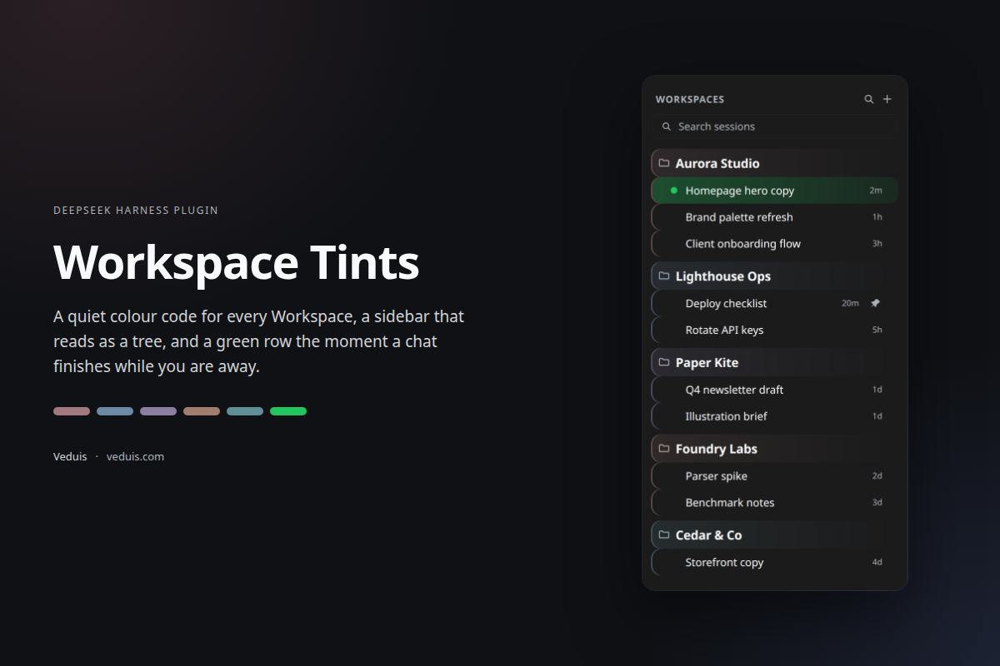
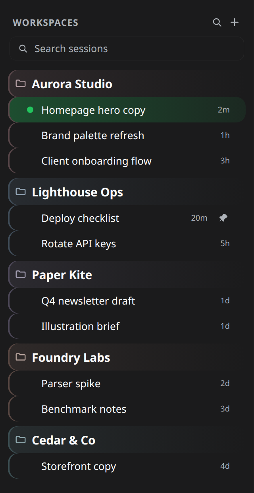
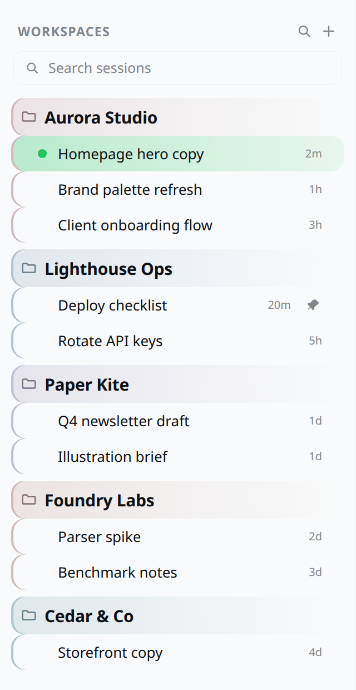
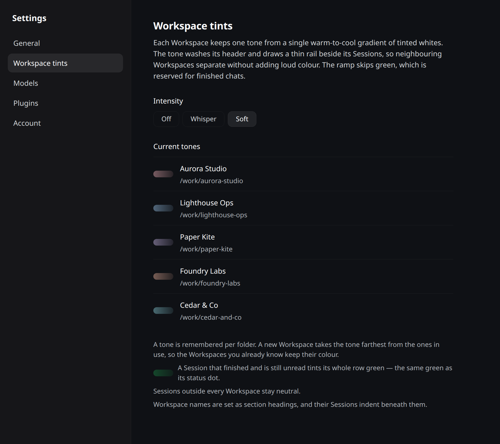

# Workspace Tints

A quiet colour code for Workspaces in [DeepSeek Harness](https://deepseek-harness.github.io/) — plus a green row the moment a chat finishes without you.

[Source](https://github.com/Veduis/dsh-workspace-tints) · [npm](https://www.npmjs.com/package/dsh-workspace-tints) · [veduis.com](https://veduis.com)



## What it does

**One tint per Workspace.** Every Workspace takes a tone from a single warm-to-cool ramp of tinted whites — never a saturated accent. The tone washes the Workspace header and draws a 2px rail beside each of its Sessions, so five open projects read as five sections instead of one long list.

**A tree, not a list.** Workspace names are set as section headings (15px, semibold, with air above them); their Sessions indent beneath in a smaller size (13px). The rail stays at the row edge, so it reads as the group's spine while the contents step in.

**A green row for finished chats.** When a Session finishes while you are elsewhere, the whole row takes a green gradient — the exact green of the status dot that already turns for it. Green is the one colour the Workspace ramp never uses, so the two signals can't be confused. The row clears the moment you open the chat.

| Dark | Light |
| --- | --- |
|  |  |

**You can turn the volume down.** Settings → *Workspace tints* shows every Workspace's current tone and switches the intensity between **Soft**, **Whisper**, and **Off**. The hierarchy and the finished-chat green are structural signals and stay on; only the tint intensity is switchable.



## Install

From a shell:

```sh
dsh plugin --profile web add dsh-workspace-tints
```

Or in the app: **Plugins → Install**, and give the package name `dsh-workspace-tints`. Reload the page if your profile does not use HMR.

It is also listed in a plugin market index, so Discover can install it without typing a package name: add `https://veduis.github.io/dsh-workspace-tints/index.json` as an index source (Plugins → More → Custom plugin markets → Discover → Add index source).

Requires a DeepSeek Harness build satisfying `engines.dsh` (currently `^0.2.1-rc.5`). The package is a bundle: `cordis.patch.yml` inserts one `workspace-tints` row, whose Client half is the stylesheet and the Settings section.

## How a tone is chosen

The tone is keyed by the Workspace's canonical folder path and remembered in `localStorage` (`dsh.workspace-tints.v1`):

- renaming a Workspace keeps its tone;
- adding a Workspace takes the tone **farthest** from the ones already in use, so existing Workspaces never change colour and new ones never sit on a neighbour's hue;
- the ramp holds twelve tones at one lightness (`oklch(0.62 0.052 <hue>)`) and skips the whole green band;
- deleting and re-adding a folder restores its old tone.

Sessions outside every Workspace stay neutral.

One migration note: assignments made before 1.0.0 are re-anchored to the green-free ramp by nearest hue, once, on first load.

## What it touches

The plugin owns one `<style>` element plus the Settings section. It reads Workspace metadata through the public `ctx.workspaces` Client service and never reads another plugin's state. Rows are addressed by the sidebar's own `data-row-key` identity (`workspace:<id>`, `session:<id>`) and the status dot's `data-state="done"`; if a future client version renames those, the affected effect stops applying and nothing else changes.

No network access, no telemetry, no analytics. The only persisted state is the tone map and intensity in `localStorage`.

## Compatibility

| DSH | Plugin |
| --- | --- |
| `^0.2.1-rc.5` | 1.0.x |

The client APIs used (`ctx.workspaces`, `ctx.slots`, `ctx.locale`, `ctx.effect`, `ctx.provide`) are stable in that range. A wider range will be declared once verified against a newer runtime.

## Uninstall

**Plugins → Workspace Tints → Remove**, or:

```sh
dsh plugin --profile web remove dsh-workspace-tints
```

The stylesheet and Settings section are disposed with the bundle. The stored tone map stays in `localStorage`, so reinstalling restores the same colours.

## About the screenshots

The images above are rendered from the plugin's own CSS against the shipped theme tokens. The Workspace and Session names in them — Aurora Studio, Lighthouse Ops, Paper Kite, Foundry Labs, Cedar & Co — are invented for the demo.

## License

MIT © [Veduis](https://veduis.com) · [source](https://github.com/Veduis/dsh-workspace-tints)
